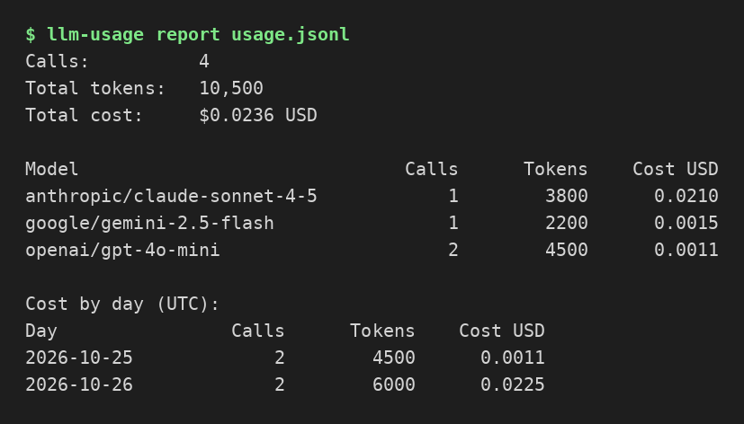

# llm-usage-tracker

A tiny, dependency-free Python library and CLI for tracking LLM token usage
and cost across providers. Record usage events as your app makes calls, get
cost estimates from a built-in pricing table, and summarize a JSONL log.

## Screenshot



The `report` command on a sample log: totals, cost by model, and cost
by day in UTC.

## Install

```bash
pip install -e .
```

## Library use

```python
from llm_usage_tracker import UsageTracker

tracker = UsageTracker(log_path="usage.jsonl")
tracker.record("openai", "gpt-4o-mini", prompt_tokens=1200, completion_tokens=300,
               label="summarizer")
print(tracker.summary())
```

Or wrap a call with `@tracked` so usage is recorded automatically:

```python
from llm_usage_tracker import UsageTracker, tracked

tracker = UsageTracker(log_path="usage.jsonl")

@tracked("openai", "gpt-4o-mini", tracker=tracker, label="summarizer")
def summarize(text):
    return "summary", 1200, 300

summarize("some text")  # returns "summary", records one event
```

The wrapped function can return a `(result, prompt_tokens,
completion_tokens)` tuple, a dict containing `prompt_tokens` and
`completion_tokens`, or an object with a `usage` attribute in either
shape (as real LLM SDK responses do). Tuple results return only the
result to the caller; dict and object results are returned unchanged.
With no `tracker` argument, a fresh tracker is created and exposed as
`wrapped.tracker`. A call that raises records nothing.

## CLI

```bash
llm-usage report usage.jsonl
llm-usage report usage.jsonl --format json
llm-usage report usage.jsonl --format csv
llm-usage top-labels usage.jsonl
llm-usage top-labels usage.jsonl --limit 5 --format json
llm-usage budget usage.jsonl --max 10.00
llm-usage budget usage.jsonl --max 10.00 --warn-pct 75 --format json
```

`budget` compares cumulative cost against a threshold: it warns once the
warn band is reached (default 80%) and exits 1 when the budget is exceeded,
so it works as a CI or cron guardrail for spending.

`report` also prints a "Cost by day (UTC)" table that groups calls, tokens,
and cost by the UTC date of each event, so you can see daily spend. The same
breakdown is available in the JSON output under the `by_day` key.

With `--format csv`, `report` emits a machine-readable CSV with columns
`section,group,calls,tokens,cost_usd`: one row per model, one row per UTC
day, and a final `total` row, ready to import into a spreadsheet.

`top-labels` ranks labels by cost, highest first (default 10, change with
`--limit`), so you can see which part of your app spends the most.
Events recorded without a label are grouped under `(unlabeled)`. The same
grouping is available in the JSON `report` output under the `by_label` key.

## Pricing

Built-in per-1K-token prices (USD) cover common OpenAI, Anthropic,
Google, xAI Grok, and DeepSeek models and were last reviewed 2026-10-22.
Unknown models fall back
to a conservative default. Override the table in code if prices drift.

## Development

```bash
pip install pytest
pytest
```
